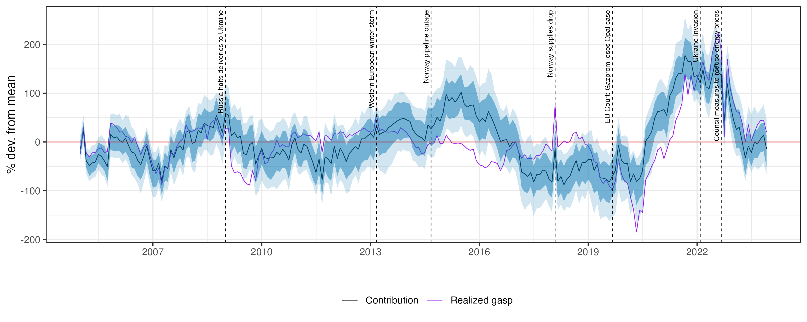

What determines the macroeconomic effects of energy-price fluctuations? We study this question in U.S. and Euro Area natural gas markets by constructing new instruments for gas-demand and supply disturbances. Exploiting exogenous temperature variation and high-frequency price movements around supply-related events, the design allows us to estimate demand and supply elasticities and distinguish realized supply disruptions from news about future scarcity. These shocks have aggregate consequences beyond gas markets. Adverse news about future gas availability generates larger, more persistent consumer-price effects than realized shortages, despite little aggregate industrial-production response. Inventory accumulation and financial-market volatility point to precautionary stockbuilding and heightened uncertainty as transmission mechanisms. Real effects depend on the margin of adjustment in gas use. In a more gas-exposed setting, consumption and investment fall alongside persistent production losses, consistent with aggregate-demand amplification; in less exposed settings, aggregate effects are limited and losses concentrated in energy-intensive industries.

This paper has also been published as a column on [VoxEU](https://cepr.org/voxeu/columns/beyond-flows-how-natural-gas-supply-risk-fuels-inflation).
